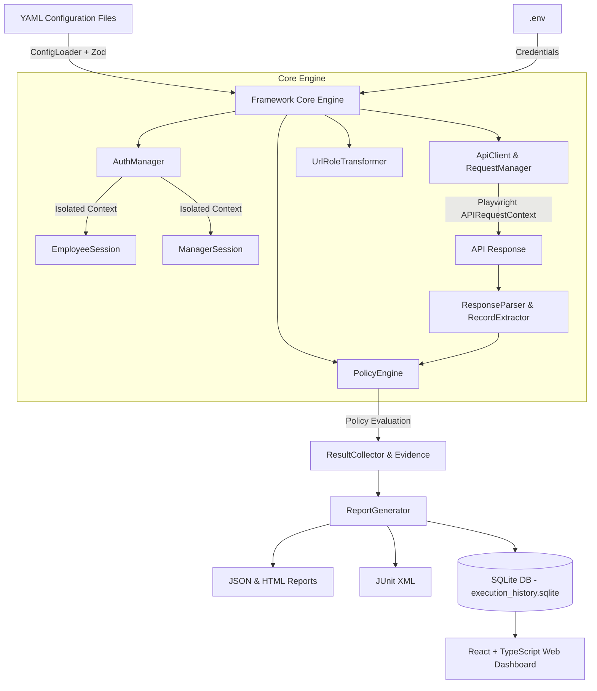

# 🛡️ Role-Based Permission (RBP) API Automation Framework

A production-grade, configuration-driven, reusable **RBP API Automation & Security Validation Framework** built with **TypeScript**, **Playwright APIRequestContext**, **React + TypeScript Dashboard**, **Express**, **YAML**, and **SQLite**.

Designed to validate whether users assigned different business roles (e.g., `Employee`, `Manager`, `Admin`, `Auditor`) can access **only** the records and endpoints permitted by their authorization tier, preventing unauthorized data leakage across tenants or roles.

---

## 🏗️ Architecture Overview



---

## 📁 Repository Structure

```
rbp-api-framework/
├── config/
│   └── projects/
│       ├── demo-rbp.yaml         # Local Mock Server configuration
│       ├── project-a.yaml        # Project A configuration example
│       └── project-b.yaml        # Project B configuration example (custom mapping)
├── src/
│   ├── api/
│   │   ├── ApiClient.ts          # Playwright APIRequestContext wrapper with retry & masking
│   │   └── RequestManager.ts     # Configured endpoint dispatcher
│   ├── auth/
│   │   ├── AuthManager.ts        # Role authentication engine
│   │   └── SessionManager.ts     # Isolated role session repository
│   ├── cli/
│   │   └── index.ts              # Commander CLI runner
│   ├── config/
│   │   └── ConfigLoader.ts       # YAML loader with Zod schema validation
│   ├── database/
│   │   └── ExecutionRepository.ts# SQLite execution history persistence (sql.js)
│   ├── mock/
│   │   └── server.ts             # Express Mock Server (GOOD & BAD RBP modes)
│   ├── rbp/
│   │   ├── PolicyEngine.ts       # ALLOW, DENY_ALL, FORBIDDEN_RECORDS evaluator
│   │   ├── RBPMatrix.ts          # Dynamic test case matrix generator
│   │   └── RBPValidator.ts       # Test executor & evidence collector
│   ├── reporting/
│   │   ├── ReportGenerator.ts    # JSON, HTML, JUnit XML generator
│   │   └── ResultCollector.ts    # Test outcome aggregator
│   ├── response/
│   │   ├── RecordExtractor.ts    # Dot-notation JSON record ID extractor
│   │   └── ResponseParser.ts     # HTTP response normalizer
│   ├── types/
│   │   └── index.ts              # Core TypeScript interfaces & types
│   ├── url/
│   │   └── UrlRoleTransformer.ts # Safe URL role path transformer
│   └── utils/
│       ├── Helpers.ts            # General helper utilities
│       ├── Logger.ts             # Masked structured logger
│       └── SecretMasker.ts       # Sensitive header/credential masker
├── tests/
│   ├── e2e/
│   │   ├── rbp-matrix.spec.ts    # Dynamic configuration-driven test execution
│   │   ├── access-control.spec.ts# Scenarios 1-5 explicit validation
│   │   └── authentication.spec.ts# Session isolation checks
│   └── unit/                     # Comprehensive unit test suite
├── dashboard/
│   ├── backend/                  # Express REST API for SQLite DB & static frontend
│   └── frontend/                 # React + TypeScript Vite glassmorphic UI
├── .env.example
├── .gitignore
├── Dockerfile
├── docker-compose.yml
├── Jenkinsfile
├── package.json
├── playwright.config.ts
└── tsconfig.json
```

---

## ⚡ Quick Start

### 1. Prerequisites
- **Node.js**: v18+ or v20+ or v24+
- **npm**: v9+

### 2. Installation
```bash
git clone <repository-url>
cd rbp-api-automation-framework
npm install
```

### 3. Environment Setup
Copy `.env.example` to `.env`:
```bash
cp .env.example .env
```
Ensure credentials are set in `.env`:
```env
USER1_EMAIL=employee@test.com
USER1_PASSWORD=Employee123!
USER2_EMAIL=manager@test.com
USER2_PASSWORD=Manager123!
```

---

## 🚀 Running Tests

### Option A: Complete Local End-to-End Demo (GOOD RBP Mode - PASS)
1. Start the local Mock API Server:
```bash
npm run rbp:mock
```
2. In a separate terminal, execute the RBP suite against `demo-rbp`:
```bash
npm run rbp:test -- --project demo-rbp
```

### Option B: Demonstrate Security Failure Detection (BAD RBP Mode - FAIL)
To verify that the framework detects unauthorized record leakage (e.g. Employee accidentally receiving Manager record `102`):
```bash
npm run rbp:test -- --project demo-rbp --bad-rbp
```

### Option C: Run Specific Roles or Tests via CLI
```bash
# Filter by session role
npm run rbp:test -- --project demo-rbp --role employee

# Filter by test ID
npm run rbp:test -- --project demo-rbp --test RBP-003
```

### Option D: Run Unit Tests
```bash
npm run test:unit
```

---

## 📊 Web Dashboard & Reports

### Launch Web Dashboard
```bash
npm run rbp:dashboard
```
Open **`http://localhost:3000`** in your browser to view:
- **KPI Summary Cards**: TOTAL, PASS, FAIL, WARN, Duration.
- **Execution Comparison**: Review historical runs stored in SQLite.
- **Interactive Results Table**: Filter by Role, Status, or search by endpoint/reason.
- **Test Evidence Modal**: View request URL, masked headers, formatted JSON response bodies.
- **RBP Matrix View**: Visual mapping of Session Roles vs Target APIs and permission rules.
- **Interactive Execution Trigger**: Execute test runs directly from the dashboard UI!

---

## 🔧 Onboarding a New Project (Config-Driven)

To onboard a brand-new application without editing any TypeScript source code, simply create a new YAML file in `config/projects/<project-name>.yaml`:

```yaml
project:
  name: Project-C
  baseUrl: https://project-c.company.com
  environment: staging

authentication:
  login:
    endpoint: /api/auth/login
    method: POST
    authType: TOKEN
    responseTokenPath: data.token
    tokenHeaderName: Authorization
    tokenHeaderPrefix: "Bearer "
  users:
    employee:
      role: employee
      emailEnv: USER1_EMAIL
      passwordEnv: USER1_PASSWORD
    manager:
      role: manager
      emailEnv: USER2_EMAIL
      passwordEnv: USER2_PASSWORD

apis:
  employee:
    method: GET
    endpoint: /employee/getEmployeeData
  manager:
    method: GET
    endpoint: /manager/getEmployeeData

records:
  employee:
    expected: ["301"]
  manager:
    expected: ["302"]

responseMapping:
  recordPath: data
  recordIdField: id

rbpRules:
  - name: Employee can access employee records
    sessionRole: employee
    apiRole: employee
    access: ALLOW
    expectedRecords: ["301"]

  - name: Employee cannot access manager records
    sessionRole: employee
    apiRole: manager
    access: DENY
    policy: FORBIDDEN_RECORDS
    forbiddenRecords: ["302"]
```

Execute tests for the new project:
```bash
npm run rbp:test -- --project project-c
```

---

## 🔒 Security Best Practices Implemented
1. **Secret Masking**: All authorization tokens, passwords, API keys, cookies, and sensitive payload keys are automatically masked before writing to console logs, HTML reports, or SQLite execution databases.
2. **Session Isolation**: Each role uses an independent `APIRequestContext`. Employee cookies/tokens can never accidentally leak into Manager requests.
3. **Safe URL Transformation**: `UrlRoleTransformer` parses URLs safely using standard URL objects, guaranteeing query parameters and encoding remain untouched.

---

## 🐳 Docker Support

Run using Docker Compose:
```bash
docker-compose up --build
```

---

## ⚙️ Jenkins CI/CD Support

Include `Jenkinsfile` in your pipeline repository. The pipeline automatically:
1. Installs dependencies using `npm ci`.
2. Fetches credentials safely from Jenkins Credentials Manager.
3. Executes Playwright RBP security tests.
4. Publishes JUnit XML test results and archives evidence reports.

---

## 📝 Known Limitations & Future Enhancements
- **PostgreSQL Adapter**: The repository interface (`IExecutionRepository`) is decoupled; a PostgreSQL adapter can be plugged in for enterprise multi-node setups.
- **OAuth2 / SAML Flow**: Currently supports POST token/cookie logins; PKCE / OAuth2 authorization code flows can be added via custom auth handlers.
